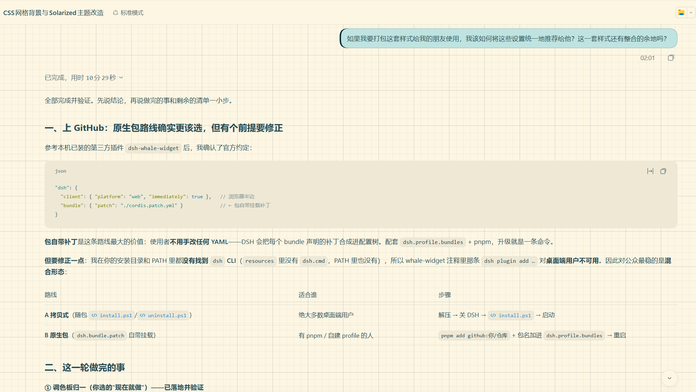
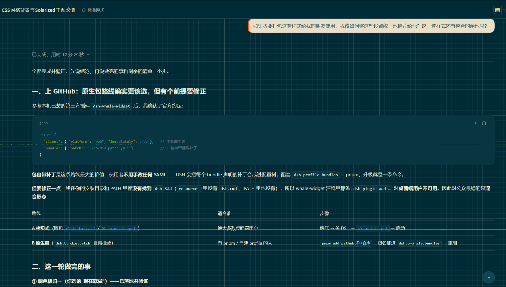
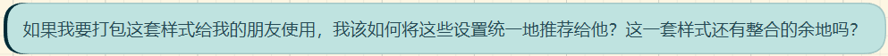

# dsh-client-ui-solarized-grid

Solarized 配色 + 网格纸背景 + 已调优的对话气泡，给 **DSH 桌面端 / Web 客户端** 用的客户端主题插件。

- **配色**：把主题表里声明的全部 `--dsw-*` 令牌（别名层、静态色阶、Shiki 语法色）重映射 —— 浅色走 **Solarized Light**，深色走 Solarized Dark。
- **背景**：来自 blue-topaz Obsidian 网格 CSS 的"网格纸"—— 75px 主线 + 15px 细线，铺在对话滚动区（`[data-conversation-scroll]`）。
- **气泡**：浅色模式是淡青卡片（`#bfe3e0`）+ 墨色左边条（`#002b36`）；深色模式是象牙卡片（`#e8dfc9`）+ 朱橙左边条（`#ff5900`），并给卡片内文字单独压深（否则浅字浅底不可读）。
- 首次加载若系统偏好解析为深色，会**一次性**pin 成浅色（之后在 设置 → 外观 里改随时生效）。

## 效果

| 浅色模式 | 深色模式 |
| --- | --- |
|  |  |
|  |  |


| 你会注意到的 | 具体取值与实测对比度 |
| --- | --- |
| **网格纸背景** | 画布 `#fdf6e3`（浅）/ `#002b36`（深）；75px 主线 + 15px 细线，`background-attachment: local` 随内容滚动，只铺在对话滚动区、不铺工具栏与侧栏 |
| **正文明显变实** | 正文 `#264b55` 在画布上 **8.77:1** —— 原版 Solarized Light 的正文 `#586e75` 只有 4.99:1；次级 `#3c5b63` 6.79:1、说明级 `#586e75` 4.99:1、注脚 `#657b83` 4.13:1 |
| **"我的消息"是一张卡片** | 浅色：淡青卡片 `#bfe3e0` + 左侧 3px 墨色条 `#002b36`（卡片内正文 6.88:1、边条 10.92:1）<br>深色：象牙卡片 `#e8dfc9` + 3px 朱橙条 `#ff5900`（卡片内文字用 scoped 深墨 `#264b55`，7.13:1；边条对画布 4.78:1、对卡片 2.37:1） |
| **卡片与"纸"分得开** | 1px 内描边 `rgba(38,75,85,.2)`；卡片与画布的感知差（OKLab ΔE）：浅色 **0.098**、深色 **0.642** |
| **代码块与语法色** | 201 项 `--dsw-*` 令牌全部重映射，代码块底色 `#eee8d5`（浅）/ `#073642`（深），Shiki 语法色一并走 Solarized |
| **深浅不是简单反转** | 浅色是"冷青卡片 + 墨线"，深色是"羊皮纸 + 朱橙线"，两套各自成立（原因见下方设计取舍） |

**已知取舍**（评审时别当成 bug）：非正文的语义色保留了 Solarized 原色 —— 例如代码块注释 `#839496` 在 `#eee8d5` 上只有 2.58:1、`state-success #859900` 2.97:1、`state-warn #b58900` 2.98:1。这是 Solarized 本身的性格（作者的设计目标是低对比、长时阅读），本主题**只压深了正文层级**，不动强调色，以免破坏语法的可辨识度。

## 安装

### 路线 A · 拷贝式（桌面端推荐，零依赖）

桌面端目前**没有** `dsh` CLI，也没有 npm 源可用时，用这条：

```powershell
# 1) 解包/克隆本仓库到任意目录
# 2) 关掉 DSH 桌面端（让补丁在启动时被读取）
powershell -File .\install.ps1
# 3) 启动 DSH
```

`install.ps1` 做两件事，都可重复执行：

1. 把 `lib/`、`package.json`、`cordis.patch.yml` 拷到 `<你的 profile>\plugins\dsh-client-ui-solarized-grid\`；
2. 幂等地往 `<profile>\cordis.patch.yml` 插入挂载行（已存在则不动），并在改动前备份该文件。

`-Profile` 默认取 `%USERPROFILE%\.dsh\profiles\desktop`，多 profile 时用 `-Profile` 指定。

### 路线 B · 原生包（有 pnpm / 自建 profile 时更干净）

本包自带挂载补丁（`dsh.bundle.patch` → `cordis.patch.yml`），所以**不需要手改任何 YAML**：

```powershell
cd "$env:USERPROFILE\.dsh\profiles\desktop"
pnpm add github:<你的账号>/dsh-client-ui-solarized-grid   # 或本地 tarball / 私有源
# 然后把包名加进 profile 的 package.json：
#   "dsh": { "profile": { "bundles": [ ..., "dsh-client-ui-solarized-grid" ] } }
# 重启 DSH
```

> 参考：本机已装的第三方插件 `dsh-whale-widget` 就是这个形态（`dependencies` + `dsh.profile.bundles` + 随包 `cordis.patch.yml`）。

## 卸载

```powershell
powershell -File .\uninstall.ps1            # 移除挂载行（并可选删除插件目录）
powershell -File .\uninstall.ps1 -Remove   # 连插件目录一起删
```

路线 B 则是：从 `dsh.profile.bundles` 里去掉包名 → `pnpm remove dsh-client-ui-solarized-grid` → 重启。

## 排错

| 现象 | 处理 |
| --- | --- |
| 界面毫无变化 | 确认 profile 的 `cordis.patch.yml` 里有 `ui-solarized-grid` 那一行；确认重启过 DSH（补丁只在启动时合成） |
| 只有配色变了、网格没出现 | 该版本客户端的对话滚动区可能没有 `data-conversation-scroll` 属性；主题表里加一行 `data-conversation-scroll` 调试即可 |
| 深色模式下气泡是浅字浅底 | 说明 scoped 深色墨规则丢了（`[data-ds-dark-theme] …{color:#264b55}`），重新构建安装 |
| 想彻底恢复 | 删掉 `cordis.patch.yml` 里的挂载行 + 删除插件目录，重启 |

## 开发 / 改配色

源码结构（`lib/` 是唯一的生成产物，一并提交，便于 git 直接安装；其余文件都是手写的发布文件本身）：

```
package.json          dsh.client（浏览器半边）+ dsh.bundle.patch（自带挂载补丁）
cordis.patch.yml      挂载行：- insert: ui-solarized-grid / name: <包名>
lib/                  生成产物：client.js（浏览器半边）、index.js（宿主半边）
src/grid.css          网格 + 气泡边条/描边 + 深色墨（手写）
src/client-template.js 客户端半边模板（注入逻辑）
src/tokens.js         生成的 201 项令牌覆盖（由 token-sheets/ 生成）
token-sheets/*.css    生成器的输入：从 DSH 安装包解出的主题样式表
tools/build-solarized-tokens.mjs     重建 src/tokens.js（16 色锚点表 S 与角色表 R 在文件顶部）
tools/build-plugin.mjs               重建 lib/
tools/apply-theme.ps1                一条命令：重建 → 安装 → 自检
tools/normalize-palette.mjs          一次性：把 curated 字面量归一到 S/R（保留作溯源）
tools/analyze-palette-derivation.mjs 分析每个颜色能否由 16 色推导、哪些是手工调色
tools/contrast-audit.mjs             对比度审计（WCAG 对比度 + OKLab ΔE 感知差）
```

调这两处即可：

- **换整套配色**：改 `tools/build-solarized-tokens.mjs` 顶部的 Solarized 锚点表 `S`（16 色）；
- **改单个元素**：改同文件的 `R` 角色表，或 `src/grid.css` 里对应的规则（网格线、气泡边条、深色墨）。

```powershell
pwsh -File .\tools\apply-theme.ps1              # 重建 + 安装（-BuildOnly 只重建）
pwsh -File .\tools\apply-theme.ps1 -BuildOnly   # 只重建，不动 profile
```

## 设计取舍（fork 前请先读）

- **网格必须画在滚动区上**，不能用 `body` 背景；用 `background-attachment: local` 让网格随内容滚动。
- **气泡边条只能用 `inset box-shadow`**：它沿圆角自然收窄（弯弧）；换成 `background-image` 渐变会变成被圆角硬切的方角。
- **深色气泡必须 scoped 覆盖文字色**：气泡文字读的是全局 `--dsw-alias-label-primary`（深色下是浅色），直接改全局会把助手正文一起改坏。
- **深色边条不为了过 3:1 对比度而加深**：橙族在本主题里已被语义占用（`#cb4b16` = 警告、`#dc322f` = 错误/删除），刚过 3:1 的 `#d94800` 与警告橙只差 ΔE 0.026，加深等于把"我的消息"做成警示徽标。

## 许可与致谢

MIT（见 `LICENSE`）；Solarized 调色板由 Ethan Schoonover 以 MIT 发布；网格 CSS 改编自 blue-topaz 的 Obsidian 片段。详见 `CREDITS.md`。
